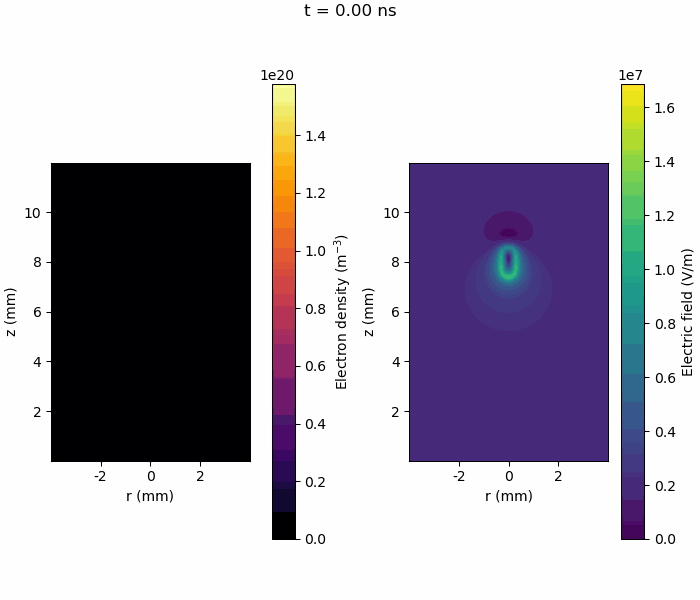
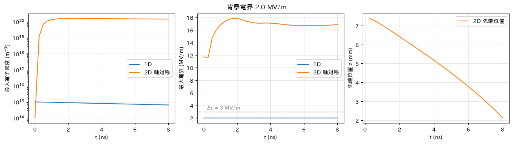
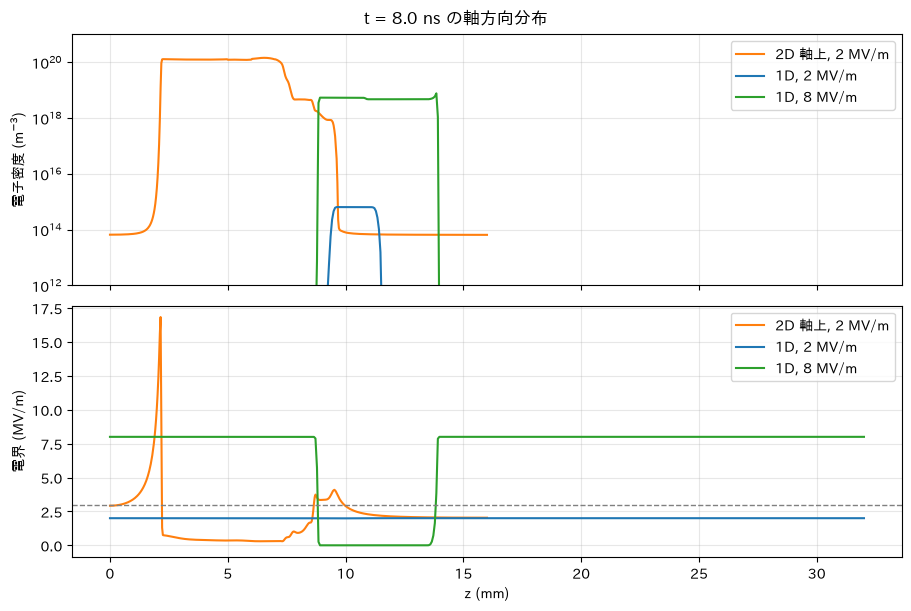
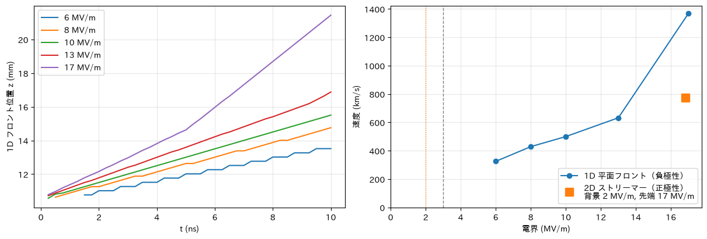
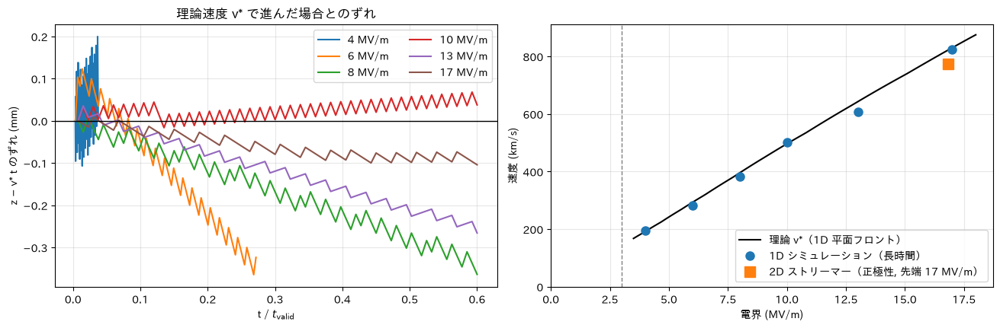

# 空気中の放電：1D 平面フロントと 2D 軸対称ストリーマーの比較

- 作成日：2026-11-22
- コード：afivo-streamer（MD-CWI/afivo-streamer の `master` = `3b693779` から分岐した `my-tools` ブランチ）
- 計算・図の再現：[`notebooks/compare_1d_2d.ipynb`](../../../notebooks/compare_1d_2d.ipynb)（通しで約 10 分）
- 環境：WSL2 Ubuntu 24.04、gfortran 13.3、Core i7-1260P、OpenMP 1〜4 スレッド

## 要点

1. **同じ背景電界 2 MV/m（空気の絶縁破壊電界 $E_k \approx 3$ MV/m 未満）で、2D ストリーマーは進み、1D 平面フロントは進まない。**
   2D では先端の電界が背景の約 8.5 倍（約 17 MV/m）に強まる。1D では電界が強まらず、電子は付着で減っていく。
2. **1D 平面フロントの速度は、理論の漸近速度 $v^* = \mu E + 2\sqrt{D\nu}$ と 4〜17 MV/m の全域で 6% 以内で一致した。**
3. 最初の短い計算で見えた 17 MV/m の「加速」（1368 km/s）は、**浮動小数点の極小値が種になる数値的な現象**だった。
   背景電離のない 1D 計算には、正しく計算できる時間の上限 $t_\mathrm{valid} \approx 776/\nu$ がある。
4. 2D ストリーマー（正極性、先端の電界 17 MV/m）の速度 773 km/s は、**同じ局所電界の 1D 平面フロント（830 km/s）より約 7% 遅い**。

## 1. 計算条件

| | 1D（`programs/standard_1d`） | 2D 軸対称（`programs/standard_2d`） |
|---|---|---|
| 元の設定ファイル | `streamer_1d.cfg` | `streamer_cyl.cfg` |
| 気体 | 空気 N2:O2 = 80:20、1 bar | 同じ |
| 輸送データ | `transport_data/td_air_siglo_swarm.txt` | 同じ |
| 光電離 | なし | なし |
| 計算領域 | 32 mm（5 節では 64 mm） | 16 mm × 16 mm |
| 種 | 中性、$10^{15}$ m$^{-3}$、z ≈ 9〜10 mm | 正イオン、$5\times10^{18}$ m$^{-3}$、軸上 z ≈ 7.7〜8.3 mm |
| 背景の電子・イオン密度 | 0 | $10^{14}$ m$^{-3}$ |
| 進むフロント | 負極性（電子が流れる向き、+z） | 正極性（背景電界の向き、−z） |

**1D で 2D の設定をそのまま使えない理由**

- 正イオンの種を置くと、1D では無限に広い平面状の電荷層になり、初期電界が $1.7\times10^{8}$ V/m を超える。8 MV/m 以上では計算が異常終了した。
- 背景電子があり $E > E_k$ だと、計算領域全体が一斉になだれ増倍を起こし（フロントではなく一様な絶縁破壊）、`dt too small` で止まった。

このため、1D は中性の種・背景密度 0 のままにした。その結果、1D と 2D で**フロントの極性が違う**。

## 2. 同じ背景電界（2 MV/m）での比較



*図 0：2D 軸対称ストリーマー（2 MV/m、0〜8 ns）。左：電子密度、右：電界。中心軸で左右に反転して表示。*



*図 1：背景電界 2 MV/m での最大電子密度・最大電界・2D の先端位置。*

| | 1D | 2D 軸対称 |
|---|---|---|
| 最大電子密度（8 ns） | $1.0\times10^{15}$ → $6.4\times10^{14}$ m$^{-3}$（付着で減少） | 約 $1.5\times10^{20}$ m$^{-3}$ |
| 最大電界 | 2 MV/m のまま | 約 17 MV/m（2 ns で最大 17.9 MV/m） |
| 速度 | 進まない | 773 km/s（先端 z ≈ 7.4 → 2.1 mm） |



*図 2：8 ns での軸方向の電子密度と電界（2D は r = 0 上）。比較のため、フロントができる 1D 8 MV/m も示す。*

- 2D は先端だけに約 17 MV/m の鋭い電界のピークがあり、チャネル内は 0.3〜0.8 MV/m まで遮蔽される。
- 1D（8 MV/m）はフロントの外側の電界が 8 MV/m のままで、強まらない。チャネル内はほぼ 0。
- 1D 8 MV/m では、z ≈ 8.8 mm 側の正極性フロントは背景電子がないため止まっていて、+z 側の負極性フロントだけが進む。

## 3. 1D 平面フロントの速度：最初の計算と数値的な加速

32 mm の計算領域、10 ns、標準の格子（`refine_adx = 1`）で電界を変えた。



*図 3：最初の 1D 計算。13・17 MV/m でフロントが加速して見える（これは数値的な現象。下記参照）。*

| E (MV/m) | 6 | 8 | 10 | 13 | 17 |
|---|---|---|---|---|---|
| 速度（後半 5 ns の平均, km/s） | 325 | 429 | 500 | 632 | **1368** |

**加速の原因の調査（17 MV/m）**

フロントの前方の電子密度を対数で調べると、背景密度 0 にもかかわらず $10^{-321}$ m$^{-3}$ 程度（倍精度で表せる下限の付近）の値が、
1 ns あたり約 1.6 mm の速さで前方に広がっていた。

| t (ns) | 1 | 2 | 3 | 4 | 5 | 6 | 7 | 8 |
|---|---|---|---|---|---|---|---|---|
| フロント位置 (mm) | 11.38 | 12.18 | 13.00 | 13.81 | 14.65 | 15.96 | 17.32 | 18.71 |
| 前方 1 mm の電子密度 (m$^{-3}$) | $10^{-196}$ | $10^{-148}$ | $10^{-115}$ | $10^{-82}$ | $10^{-49}$ | $10^{-45}$ | $10^{-44}$ | $10^{-45}$ |

- 0〜4 ns の速度は約 810 km/s で、理論値 $v^*$ = 830 km/s とほぼ一致する。
- 5 ns 以降は、前方に散らばった極小の密度が $e^{\nu t}$（$\nu = 1.24\times10^{11}$ s$^{-1}$）で育って先にしきい値を超え、見かけ上 1350 km/s 程度に加速する。

極小値 $10^{-321}$ からフロント判定のしきい値 $n_\mathrm{th}$ まで増えるのにかかる時間が、正しく計算できる上限になる。

$$t_\mathrm{valid} \approx \frac{\ln(n_\mathrm{th}/10^{-321})}{\nu}$$

| E (MV/m) | 4 | 6 | 8 | 10 | 13 | 17 |
|---|---|---|---|---|---|---|
| $\nu$ (s$^{-1}$) | $7.2\times10^{8}$ | $5.3\times10^{9}$ | $1.5\times10^{10}$ | $3.1\times10^{10}$ | $6.4\times10^{10}$ | $1.2\times10^{11}$ |
| $t_\mathrm{valid}$（$n_\mathrm{th}=10^{16}$） | 1.07 μs | 147 ns | 51 ns | 25 ns | 12 ns | 6.2 ns |

実際には $0.75\,t_\mathrm{valid}$ 付近から加速が見え始めたので、以後は計算時間を $0.6\,t_\mathrm{valid}$ 以下にした。

> 実際の空気には背景電離（$10^{9}$ m$^{-3}$ 程度以上）があるので、強い一様電界では前方も一斉に絶縁破壊する。
> 「背景電離なしの平面フロント」自体が、強い電界では短い時間しか成り立たない理想化である。

## 4. 格子の細かさの影響（6 MV/m）

64 mm、30 ns の計算で、格子の細かさを変えた（理論値 $v^*$ = 293 km/s）。

| 設定 | 速度 (km/s) | 理論との差 | 最小格子幅 | 計算時間 |
|---|---|---|---|---|
| `refine_adx = 1`（標準） | 319 | +9% | 31 μm | 5 秒 |
| `refine_adx = 0.25` | 280 | −4% | 7.8 μm | 73 秒 |
| `refine_adx = 0.25`、`refine_max_dx = 2e-5` | 280 | −4% | 7.8 μm | 74 秒 |

標準の格子では数値拡散のためフロントが速く出る。細かくすると理論値の下側（理論が予想する「下から近づく」側）に収まり、それ以上細かくしても変わらない。

ただし強い電界で `refine_adx = 0.25` にすると、前方の全域が細かい格子になり、13 MV/m で 6 万セルを超えて 30 分経っても 25% しか進まなかった。
そこで電界ごとに `refine_adx` を変えた（4・6 MV/m：0.25、8 MV/m：0.5、10 MV/m 以上：1）。

## 5. 1D を長く計算した結果と理論との比較

理論速度（背景電離のない平面の負極性フロント、"pulled front"）：

$$v^* = \mu E + 2\sqrt{D\,\nu}, \qquad \nu = (\alpha - \eta)\,\mu E$$

$\mu, D, \alpha, \eta$ は計算に使われた輸送データ（`output/<name>_summary.txt`）から取った。
計算領域は 64 mm（種の位置は同じ）、フロント判定のしきい値は `output%density_threshold = 1e16`
（4 MV/m では電子密度が $2.5\times10^{17}$ m$^{-3}$ で頭打ちになり、標準の $10^{18}$ では検出できないため）。



*図 4：左：理論速度 $v^*$ で進んだ場合とのずれ（横ばいなら理論どおり。ギザギザはフロント位置が格子の幅で刻まれるため）。
右：速度と電界の関係。黒線が理論、丸が 1D、四角が 2D ストリーマー（先端の電界に対してプロット）。*

| E (MV/m) | 理論 $v^*$ (km/s) | ドリフト速度 $\mu E$ (km/s) | 1D 計算 (km/s) | 計算 / 理論 | 計算時間 | `refine_adx` |
|---|---|---|---|---|---|---|
| 4 | 192 | 172 | 194 | 1.01 | 40 ns | 0.25 |
| 6 | 293 | 235 | 281 | 0.96 | 40 ns | 0.25 |
| 8 | 395 | 292 | 383 | 0.97 | 31 ns | 0.5 |
| 10 | 496 | 343 | 501 | 1.01 | 15 ns | 1 |
| 13 | 643 | 413 | 608 | 0.95 | 7.3 ns | 1 |
| 17 | 830 | 497 | 825 | 0.99 | 3.7 ns | 1 |

- 全点で理論と 6% 以内。数値的な加速は出ていない。
- 細かい格子の点（4〜8 MV/m）と 13 MV/m は理論の少し下で、「$v^*$ に下から近づく」という理論の予想と合う。13 MV/m は計算時間が短く、まだ近づく途中と考えられる。
- 10 MV/m が 1% 上なのは、標準の格子による数値拡散の影響の可能性がある。

## 6. 考察

- **電界集中の効果**：2 MV/m の背景電界では、1D は進まず、2D は先端で約 17 MV/m まで電界が強まって 773 km/s で進む。
  ストリーマーが絶縁破壊電界より低い電界で進めるのは、細い先端の空間電荷による電界集中のためであることが、1D との比較で直接確かめられる。
- **局所電界で見た速度**：2D ストリーマーの点（17 MV/m、773 km/s）は 1D の理論曲線 $v^*$（830 km/s）より約 7% 下にある。
  差の原因の候補は次のとおり。
  - 極性の違い（2D は正極性、1D は負極性。負極性は電子のドリフトに乗るので一般に速い）
  - 先端の曲率（2D の強い電界は先端のごく狭い範囲だけ）
  - 2D には背景電離 $10^{14}$ m$^{-3}$ があり、1D にはない
- **1D 計算の注意点**：背景電離のない 1D では、計算時間を $t_\mathrm{valid}$ より十分短くすること。また、弱い電界では格子を細かくすること。

## 7. 今後の候補

- 2D で負極性のストリーマーを作り、1D と極性を揃えて比べる
- 2D で背景電界を変え（1.5〜2.5 MV/m など）、先端の電界と速度の関係を 1D の理論曲線と比べる
- 光電離（`[photoi] enabled = t`）を入れて、背景電離の代わりにしたときの違いを見る
- 2D の格子の細かさ（`refine_adx`）の影響を確認する（今回は 2D の格子依存性は調べていない）

## 8. 再現方法

```bash
cd ~/afivo-streamer && git switch my-tools
make                                   # 初回のみ（afivo/tools でも make）
cd notebooks && ~/venvs/afivo/bin/jupyter lab   # compare_1d_2d.ipynb を上から実行
```

使ったファイル：
- [`notebooks/compare_1d_2d.ipynb`](../../../notebooks/compare_1d_2d.ipynb)：この比較のすべての計算と図
- [`notebooks/afivo_helpers.py`](../../../notebooks/afivo_helpers.py)：`run_streamer()`、`load_log()`、`load_lineout()`、`front_velocity()`、`pulled_front_velocity()` など
- [`tools/make_movie.py`](../../../tools/make_movie.py)：図 0 の動画

3 節の極小密度の調査（表）と 4 節の格子の比較は、ノートブックの外で個別に実行した計算の結果である。
