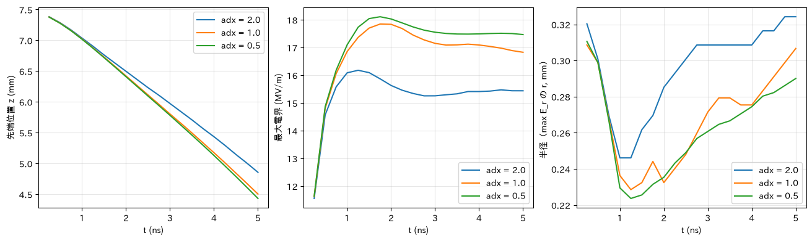
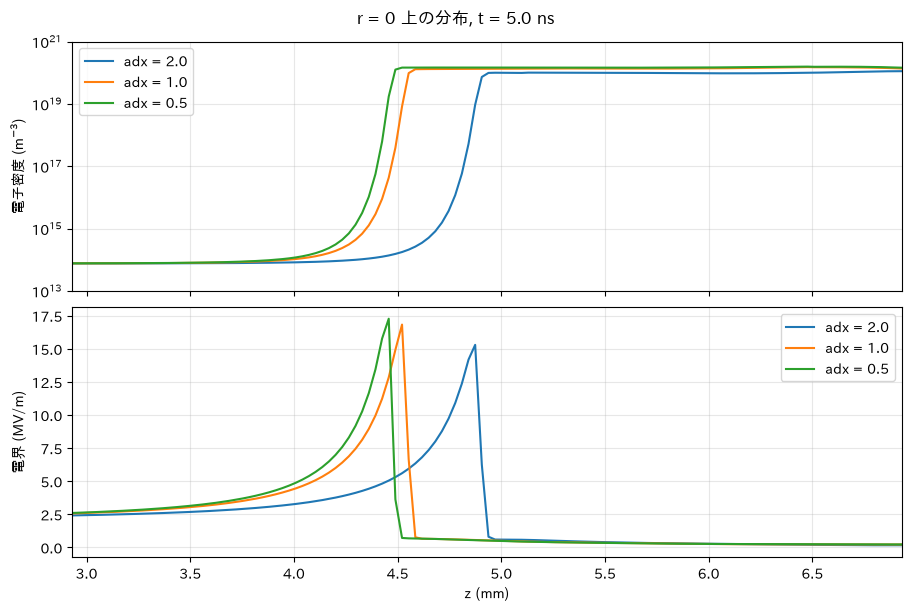
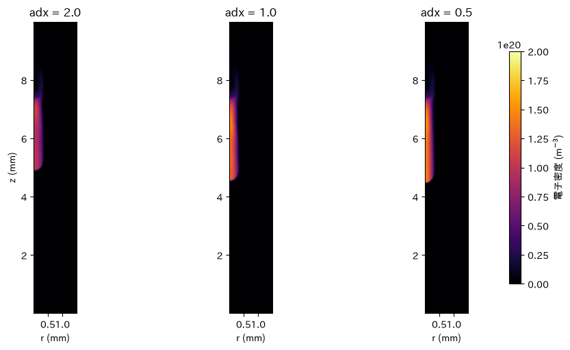

# 2D 軸対称ストリーマーの格子依存性

- 作成日：2026-11-22
- コード：afivo-streamer の `my-tools` ブランチ（本家 `master` = `3b693779` から分岐）
- 計算・図の再現：[`notebooks/grid_2d.ipynb`](../../../notebooks/grid_2d.ipynb)（計算済みなら約 1 分、計算し直すと約 30 分）
- 環境：WSL2 Ubuntu 24.04、gfortran 13.3、Core i7-1260P、OpenMP 4 スレッド

## 要点

1. **標準の格子（`refine_adx = 1`）は、細かい格子（0.5）より速度を 3.4%、先端の電界を 2.3% 低く出す。** 半径は 2.3% 大きく出る。
2. 格子を半分にするごとに、細かい格子との差が **約 1/4 に縮んでいて**、結果は収束に向かっている。
3. この縮み方が続くと仮定すると、格子を無限に細かくした値は **速度 約 680 km/s、先端の電界 約 17.7 MV/m** と見積もれる。
   標準の格子のずれは、速度で約 −5%、電界で約 −3% になる。
4. `refine_adx = 2` は粗すぎる（速度 −17%、電界 −13%）。
5. 計算時間は、2：23 秒、1：3 分、0.5：24 分。**普段は標準の 1 を使い、数 % の精度が要る結論を出すときだけ 0.5 で確かめる**のが現実的。

1D の平面フロントでは、標準の格子だと速度が**速く**出た（6 MV/m で +9%、[1D と 2D の比較](../1d_vs_2d_air/README.md) の 4 節）。
2D では逆に**遅く**出ていて、ずれの向きは次元によって違う。

## 1. 計算条件

- 元の設定：`programs/standard_2d/streamer_cyl.cfg`
  - 空気（N2:O2 = 80:20、1 bar）、輸送データ `td_air_siglo_swarm.txt`、光電離なし
  - 背景電界 2 MV/m、背景密度 $10^{14}$ m$^{-3}$、正イオンの種（正極性ストリーマー）
  - 計算領域 16 mm × 16 mm
- 変えたもの：`refine_adx`（$\alpha\,\Delta x$ がこの値より大きいセルを細分化する。小さいほど格子が細かい）
- 計算時間：5 ns

比べた量：

| 量 | 求め方 |
|---|---|
| 速度 | 先端位置 `ne_zmin` の傾き（1〜5 ns のうち後半の点で直線近似） |
| 先端の電界 | 最大電界 `max(E)` の 2〜5 ns の平均 |
| 半径 | 径方向の電界が最大になる r 座標（`max(E_r)` の位置）の 2〜5 ns の平均 |

## 2. 結果

| `refine_adx` | 速度 (km/s) | 先端の電界 (MV/m) | 半径 (mm) | 5 ns の先端位置 (mm) | 最小格子幅 | セル数（5 ns） | 計算時間 |
|---|---|---|---|---|---|---|---|
| 2 | 558 | 15.40 | 0.309 | 4.86 | 7.8 μm | 15,232 | 23 秒 |
| 1（標準） | 651 | 17.20 | 0.272 | 4.50 | 2.0 μm | 25,600 | 3 分 |
| 0.5 | 674 | 17.60 | 0.266 | 4.43 | 1.0 μm | 60,736 | 24 分 |

`refine_adx = 0.5` との差：

| `refine_adx` | 速度 | 先端の電界 | 半径 |
|---|---|---|---|
| 2 | −17.2% | −12.5% | +15.9% |
| 1 | −3.4% | −2.3% | +2.3% |



*図 1：先端位置・最大電界・半径の時間変化。半径が階段状なのは、ログの位置が格子の幅で刻まれるため。*



*図 2：5 ns での中心軸（r = 0）上の電子密度と電界（先端付近を拡大）。*



*図 3：5 ns での電子密度の分布。`adx = 2` はチャネル内の密度が低く（約 $1\times10^{20}$ m$^{-3}$、ほかは約 $1.5\times10^{20}$）、先端も遅れている。*

## 3. 収束の見積もり

格子を半分にしたときの差（粗い → 細かい）：

| 量 | 2 → 1 | 1 → 0.5 | 比 |
|---|---|---|---|
| 速度 | +92.4 km/s | +23.2 km/s | 4.0 |
| 先端の電界 | +1.80 MV/m | +0.41 MV/m | 4.4 |

差が約 1/4 ずつ縮んでいるので、同じ縮み方が続くと仮定して残りの差を足し合わせると（$\Delta/3$ を加える）、

- 速度：$674 + 23.2/3 \approx$ **682 km/s**
- 先端の電界：$17.60 + 0.41/3 \approx$ **17.7 MV/m**

この値に対するずれは、標準の格子（1）で速度 −4.5%・電界 −3.0%、0.5 で速度 −1.1%・電界 −0.8% になる。

**注意**：これは 3 点からの見積もりで、縮み方がこのまま続くという仮定に基づく。
また、`refine_adx` を半分にしても最小格子幅はちょうど半分にはなっていない（2 → 1 では 7.8 → 2.0 μm）。
`refine_adx = 0.25` の計算（最小格子幅 0.49 μm）は時間がかかるため、このまとめには含めていない（下記）。

## 4. 今後の使い方

- 普段の計算や傾向を見る目的では、標準の `refine_adx = 1` で十分（速度・電界のずれは数 %）。
- 速度や電界の値そのものを数 % の精度で議論するときは、`refine_adx = 0.5` で確かめるか、上の見積もりのようにずれを見込む。
- `refine_adx = 2` は使わない。
- 背景電界・気体・光電離などの条件を変えると、ずれの大きさも変わり得る。新しい条件で主な結論を出すときは、同じ確認をする。

## 5. 未完了の確認

- `refine_adx = 0.25`：まとめの時点で 5 ns 中 1.5 ns まで（約 30 分）。最後まで計算するには 1.5 時間以上かかる見込み。
  計算が終われば、`grid_2d.ipynb` を実行し直すだけで比較に加わる（`RUN_FINEST = True` にすると、ノートブックから計算することもできる）。
- 2D の格子依存性は、背景電界 2 MV/m の 1 条件でしか調べていない。

## 6. 再現方法

```bash
cd ~/afivo-streamer && git switch my-tools
cd notebooks && ~/venvs/afivo/bin/jupyter lab   # grid_2d.ipynb を上から実行
```

使ったファイル：
- [`notebooks/grid_2d.ipynb`](../../../notebooks/grid_2d.ipynb)：計算・表・図
- [`notebooks/afivo_helpers.py`](../../../notebooks/afivo_helpers.py)：`run_streamer(..., reuse=True)` で計算済みの結果を再利用する
